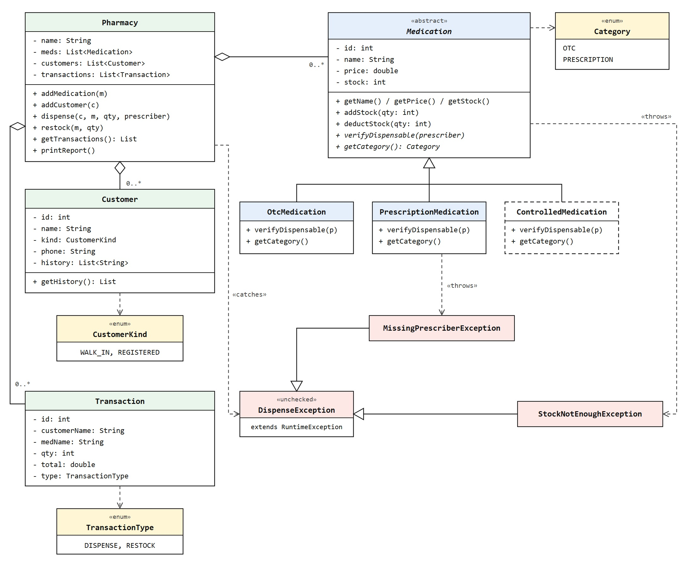

# Diagnosis: Akosua's Pharmacy

## 1. Method

I cloned the starter repository, compiled it and ran it before changing any code. The untouched output is saved in [`expected-output-before.txt`](expected-output-before.txt) and is my baseline for proving behaviour is preserved. The original file was committed on its own, then this document, before my first code change.

To reproduce the baseline (from Git Bash, so the file is saved as plain UTF-8):

```bash
java src/main/java/PharmacyTracker.java > expected-output-before.txt
```

## 2. What I observed

Amoxicillin starts at 40 units. One unit is dispensed to Ama Owusu, leaving 39. A later dispense of 100 units to Kofi Mensah then goes through anyway. Stock drops to minus 61, the customer is billed, a transaction is recorded, and the end of day report prints the impossible number without complaint.

## 3. Problems found, ranked by danger to this business

### Problem 1 (MOST DANGEROUS): Stock can silently become invalid

**Symptom:** `dispense` subtracts the requested quantity with no check that enough stock exists, so counts go below zero.

**Root cause:** every field on `Medication` is public, so no single piece of code owns the rule that stock can never be negative. Adding a check inside `dispense` alone would not fix it, because `restock`, `main` or any future code could still write a bad number straight into the field. The same lack of checks also means a negative `qty` passed to `dispense` would add stock and charge a negative total, and a negative `qty` passed to `restock` would lower stock. The `addStock` and `deductStock` guards in the redesign fix this too.

**Business risk:** in a pharmacy the count is trusted. Staff can promise a patient a medicine that is not on the shelf, or record a sale of stock that never existed. For prescription medicines this is a patient safety and record keeping problem, and the pharmacy cannot reconcile what was really dispensed. Once Akosua sees one impossible count she cannot trust any count, which is exactly why she stopped trusting the tool.

**Why it ranks first:** it is the only problem that produces wrong data about real medicine on the shelf. The others create risk of future mistakes or untrustworthy records, but only this one is already happening in production.

### Problem 2: Rules for each kind of medicine are hard coded in one method

**Symptom:** `dispense` branches on the category string, and the OTC and prescription branches duplicate the total calculation, the discount, the stock subtraction and the print.

**Root cause:** behaviour that belongs to each kind of medicine lives in the pharmacy instead, selected by comparing strings.

**Business risk:** this is why a change to one kind of medicine has quietly broken another. Controlled substances, arriving soon, would mean a third branch in the same method, risking the two that work. Note also that an unrecognised category silently falls through: no dispense happens, but a GHS 0 transaction and a customer history entry are still recorded, so the records show a sale that never occurred. The prescriber check is also weak: it only tests for `null`, so an empty string `""` passes as a valid prescriber, which matters especially for the controlled substances Akosua is about to add.

### Problem 3: Categories and customer kinds are raw strings

**Symptom:** `"OTC"`, `"PRESCRIPTION"`, `"WALK_IN"` and `"REGISTERED"` are compared as text.

**Root cause:** the compiler cannot check them.

**Business risk:** a typo such as `"Prescription"` compiles fine and silently takes the wrong path, or no path at all. A `null` category or customer kind crashes the program entirely with a `NullPointerException`, since the string comparisons don't guard against it.

### Problem 4: The audit trail can be altered from outside

**Symptom:** `getTransactions()` returns the real internal list, and the `meds` and `customers` lists in `Pharmacy` are public.

**Root cause:** internal collections are handed out directly instead of through controlled methods or read only views.

**Business risk:** any caller can add, remove or clear transactions, so the record of what was dispensed cannot be trusted.

### Problem 5: Recorded details are inconsistent

**Symptom:** a restock records a total of zero and a hard coded supplier label. Ids come from static counters shared across the whole program.

**Root cause:** the transaction model has no notion of different transaction types, and id generation is global mutable state.

**Business risk:** lower than the above, but it limits reporting and makes testing awkward.

### Known risk, deliberately left unchanged: money stored as `double`

Binary floating point cannot represent decimal amounts exactly, so totals after discounts can drift by tiny fractions. I left it as is in the rebuild so that the output stays identical to the original and my behaviour comparison stays clean. The recommended next step is `BigDecimal` or whole pesewas stored as a `long`.

## 4. Planned structure (sketch attached separately)

My sketch is in [`design-sketch.jpg`](design-sketch.jpg):

[](design-sketch.jpg)

In words:

- `Medication` becomes an abstract base class with private fields. Stock is changed only through `addStock(int)` and `deductStock(int)`. Both reject invalid input, and the constructor goes through the same validation.
- `Medication` declares one abstract method, `verifyDispensable(String prescriber)`, returning nothing and throwing if the rule is broken.
- `OtcMedication` accepts any prescriber, including none.
- `PrescriptionMedication` throws if the prescriber is missing.
- Later, `ControlledMedication` extends the base and overrides that one method with stricter rules. No existing class needs to change.
- `DispenseException` is an unchecked parent exception. `StockNotEnoughException` and `MissingPrescriberException` extend it, so `Pharmacy` catches one type and prints the message each exception carries.
- Enums replace the raw strings for customer kind.
- Category strings are handled differently, through subclasses rather than a stored field, because each category carries different behaviour, not just a label. The report still prints `(OTC)` and `(PRESCRIPTION)`, so `Medication` declares an abstract `getCategory()` that returns a `Category` enum, and each subclass returns its own constant. Category is never stored as a field, so a class and its category can never disagree, and printing the enum keeps that output identical. The `Transaction` type strings `"DISPENSE"` and `"RESTOCK"` are also candidates for an enum.
- `Pharmacy.dispense` runs in this order: verify the prescriber rule, calculate the total with any registered discount, deduct stock, add the customer history entry, record the transaction, print the success message. If prescriber verification fails or the stock deduction throws, nothing after it runs, so a refused sale leaves no history entry and no transaction.
- Getters return unmodifiable views so the audit trail cannot be rewritten from outside.

## 5. Expected difference from the original

The rebuilt output should match the baseline line for line with exactly one intentional change: the final dispense of 100 amoxicillin is refused with a message, no transaction is recorded, and amoxicillin stays at 39 instead of minus 61. That single difference is the rule the business said must never be broken.

The rebuilt output is in [`actual-output-after.txt`](actual-output-after.txt). Compared with the baseline, that one change shows up as three lines and nothing else differs:

| Line | Before | After |
|---|---|---|
| 4 | `Dispensed 100 x Amoxicillin 250mg to Kofi Mensah (prescribed by Dr. Boateng) for GHS 3000.0` | `Cannot dispense 100 x Amoxicillin 250mg: only 39 in stock` |
| 9 | `Amoxicillin 250mg (PRESCRIPTION): -61 in stock` | `Amoxicillin 250mg (PRESCRIPTION): 39 in stock` |
| 10 | `Transactions today: 4` | `Transactions today: 3` |

To reproduce it (from Git Bash):

```bash
javac -d target/classes $(find src/main/java -name '*.java')
java -cp target/classes PharmacyTracker > actual-output-after.txt
diff expected-output-before.txt actual-output-after.txt
```

## 6. Design changes during the build

- **`StockNotEnoughException` renamed to `InsufficientStockException`.** "Insufficient stock" is the standard phrase in Java and in retail, and it reads more clearly at the throw site. The class does the same job in the same place in the hierarchy, so the sketch above still shows it under its original name.
- **Exceptions build their own messages.** Instead of a free-text message, each exception takes the facts it needs (`InsufficientStockException(medName, requested, available)`, `MissingPrescriberException(medName)`) and writes the message itself. Every refusal of the same kind is worded the same way, and the missing-prescriber message keeps the original program's exact wording.
- **`DispenseException` is abstract.** It exists only as the one type `Pharmacy` catches, so it cannot be thrown on its own.
- **Added a private `requirePositive(qty)` helper in `Medication`.** It isn't in the sketch. `addStock` and `deductStock` both use it, so the quantity check lives in one place.
- **Names and price can change through `final` setters.** Pharmacy, medication and customer names, and medication price, each have a setter that rejects blank or invalid values. The setters are `final` so a subclass can't skip the check, and the constructors use them too. Transactions already recorded keep the name used at the time of sale.
- **A blank prescriber is refused too, not just `null`.** This closes the gap noted in Problem 2. The output doesn't change since `main` never passes a blank one.
- **Every field has a getter, and a validated setter where it makes sense.** The sketch only showed the main methods, but since the fields are private now these are the only way to read or change them. Each setter runs the same check as the constructor, and the constructor calls the setter so the check lives in one place. A few fields don't get setters on purpose:
  - `stock` changes only through `addStock` and `deductStock`.
  - The pharmacy's lists change only through `addMedication`, `addCustomer`, `dispense` and `restock`, and their getters return read-only copies.
  - `id` is handed out once by the counter, so a setter could create duplicates.
  - `Transaction` has getters only. It's the audit record of a sale, so it shouldn't be editable after the fact (Problem 4).
- **`Customer.addHistory(medName, qty)` added.** It's package-private so only `Pharmacy` can write history, and `getHistory()` stays read-only.
- **The registered discount is a constant.** `REGISTERED_DISCOUNT = 0.95` in `Pharmacy` replaces the `0.95` that was repeated in both branches.
- **`meds` renamed to `medications`** in `Pharmacy` for readability.
